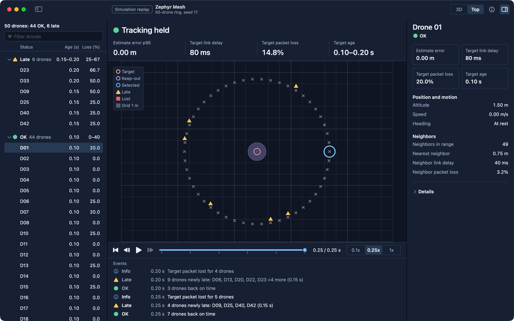
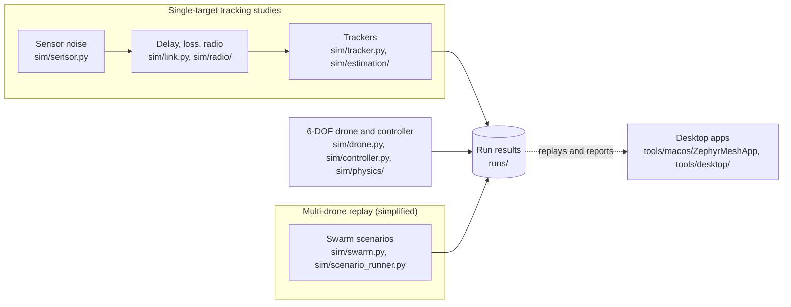
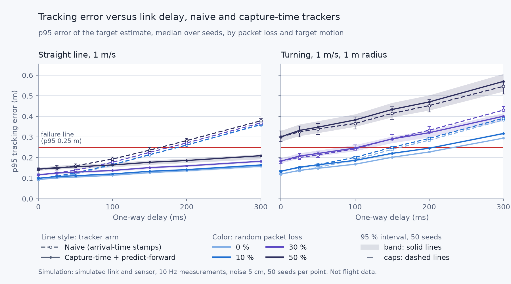
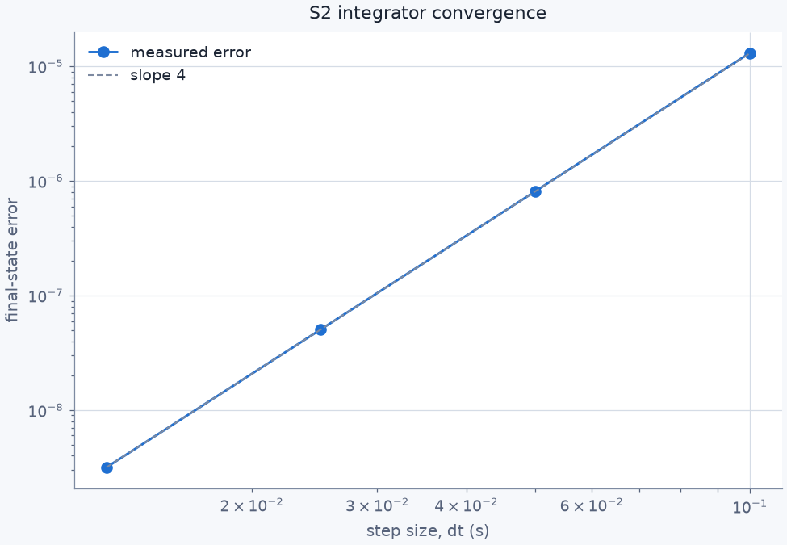

# Zephyr Mesh

**How much radio lag and packet loss can a team of drones take before they lose track of a target, and what helps them recover?**

*Screenshot of a synthetic replay in the macOS app, paused on its last frame. No real drones or radio data.*

Zephyr Mesh is a simulator I'm building to study cooperative drone tracking before working with hardware. It models one quadcopter as a full 6-degree-of-freedom rigid body, an unreliable radio link (delay, jitter, dropped and out-of-order packets, plus an ESP-NOW style radio model), trackers that estimate a moving target, and a simplified multi-drone layer. Everything is simulated: no drone has been built or flown.

These are related but separate pipelines. The tracking studies, the drone and controller checks, and the multi-drone replay each write results to `runs/`. The apps replay the multi-drone files and open reports made from the other results. There is no single live system that runs all of it end to end.

## Results

All of these are simulated. Nothing is measured on hardware. The failure line below is 0.25 m of tracking error, a research criterion, not a safety limit.

- A basic tracker's error grows by about speed x delay. Its p95 error (the error it stays under 95 % of the time) crosses the 0.25 m line at 200 ms of delay with no loss, for a 1 m/s target, 10 Hz measurements, 5 cm noise and 50 seeds. The 200 ms depends on the sensor noise (the filter is always told 5 cm): with 0 or 2 cm it still passes at 200 ms and first fails at 300 ms (the next delay tested), and with 10 cm it fails from 150 ms (`runs/s6-recovery`).
- Stamping each measurement with the time it was taken, then predicting forward, cuts the 300 ms error with no loss from 0.36 m to 0.16 m on a straight line, and from 0.38 m to 0.29 m on a 1 m radius turn (`runs/s6-recovery`).
- On the turn, lost packets matter more than delay: at 30 % random loss the recovery tracker fails from 150 ms just like the basic one, and at 50 % both fail at every delay (`runs/s6-recovery`).
- On a 1 m radius turn at 300 ms delay and 30 % loss, a tracker that models turning stays under the line (0.20 m) where the straight-line recovery tracker fails (0.40 m) (`runs/s6-turn`).
- Delaying the drone's own position and velocity feedback is what really hurts its control loop: in an 80 s check, two micro-quad profiles built from published specs at 0.33 s of delay the wobble after a 1 m step still shrinks, but slowly (its peak in each 10 s window falls from 0.73 m to 0.41 m over 80 s), and at 0.34 s it grows instead (up to 1.24 m) (`runs/a6-long-check`, `runs/a6-control-tolerance`).
- In a simulated ESP-NOW style link, the worst p95 radio latency in the tracker test was about 27.5 ms (the median over repeated runs; the worst single run was about 40 ms), well under the 200 ms where the tracker starts failing from delay at 5 cm noise (150 ms at 10 cm), so lost packets break it first (`runs/c-exp017-tolerance-r2`).
- Twelve drones each sending 32-byte packets 50 times a second keep the channel about two thirds busy. With retries every packet arrives, with a p95 latency of 4.4 ms. This assumes no outside Wi-Fi traffic and that every drone hears every other one (`runs/c-exp014-mac-r2`).

Full results, limits and commands: [docs/RESULTS.md](docs/RESULTS.md)

## Results you can check yourself

Set up once with the steps in [docs/INSTALL.md](docs/INSTALL.md#run-from-source), then run these from the repository root.

| Check | What it shows | Command |
| --- | --- | --- |
| RK4 accuracy | Error drops about 16x each time the time step halves, ratios of 16.09, 16.03 and 16.01, so order about 4, as expected for RK4 (plot: `runs/s2-physics-v2/a_s2_convergence.png`) | `PYTHONPATH=. python tools/make_s2_convergence.py --output /tmp/convergence.json` |
| Step response | Vertical 3 m step: 8.4 % overshoot, settles in 3.0 s; 1 m sideways step: 19 % overshoot, settles in 3.4 s (plot: `runs/s0-baseline-v2/a_s0_baseline_v2.png`) | `PYTHONPATH=. python tools/a_make_s0_baseline_v2.py --output-dir /tmp/s0-v2` |
| Controller timestep limit | The controller refuses time steps at or above 2/18 = 0.111 s, where its attitude damping would go unstable | `python -m pytest tests/test_vehicle.py -k sampled_attitude_limit` |
| Reproducibility | Running the same scenario and seed twice gives byte-identical output (run it twice to two files and compare them with `cmp`) | `PYTHONPATH=. python tools/run_scenario.py --config sim/scenario_example.json --output /tmp/run.json --summary` |
| Every published run | Reruns each registered run from a clean copy and checks its output hashes. Slow: several hours. The `s6-sending` and `s6-atlas` runs each took over an hour when they were made, longer than the default 1 hour limit. `--timeout 10800` gives each run up to 3 hours (10800 seconds). | `python tools/reproduce_all.py --timeout 10800` |

These commands need Python 3.12 or 3.13 (3.14 is untested) and a bash or zsh terminal (Git Bash on Windows, untested there). `reproduce_all.py` copies the repository with `git archive`, so it also needs a git clone and `git` on your PATH. A ZIP download from GitHub will not work.

## What this is not

- It is not flight-tested. All data is simulated.
- The multi-drone layer is simplified point-mass coordination, not full 6-DOF swarm flight.
- Many radio and motor values come from published sources. The rest are scaled from a similar drone, set by modelling choices, or not yet confirmed. Sensor noise, update rates, delay and loss are settings I chose for the study. I did not measure any of these values myself.
- No hardware has been built yet.

## Download

Get [Zephyr Mesh v0.2.4](https://github.com/Whyater/Zephyr-Mesh/releases/tag/v0.2.4) for macOS 14 or newer (Apple Silicon and Intel) or Windows x86_64.

The builds are unsigned or only ad hoc signed, so expect a one-time security prompt the first time you open them.

Full install and build steps: [docs/INSTALL.md](docs/INSTALL.md)

## Current features

- A full 6-degree-of-freedom quadcopter simulation with wind, drag, an RK4 integrator and a cascaded position and attitude controller. Drag is switched off in the two micro-quad profiles, which have no sourced drag value.
- A radio link model with delay, jitter, random and bursty loss, duplicates and out-of-order packets, plus an ESP-NOW style radio model.
- Seeded sensor noise and several trackers, with sweeps that compare how well each one recovers from delay and loss.
- Simplified multi-drone scenarios (formation, dropouts, keep-out zones) that write reproducible replay files.
- Motor, propeller and battery models, plus file formats for hardware parts and future bench, radio and camera recordings.
- A macOS app and a Windows app that replay the same synthetic data. They are read-only.

Full list: [docs/FEATURES.md](docs/FEATURES.md)

## Planned features

These are plans. None of them is built yet.

- Measure ESP-NOW latency, loss, update rate, and contention on real hardware, then feed those traces into the link model.
- Size camera and sensor noise from recorded measurements and validate tracker recovery against those traces.
- Calibrate motor, propeller, battery, and airframe parameters from bench data, including the limits of the current transparent model.
- Add hardware adapters and a ground-station interface behind the existing `DroneAdapter` contract.
- Add supervised mission authoring, replay export, explicit controller assignment, team-command arbitration, and link-loss recovery workflows.
- Measure Windows and macOS target-device parity for frame time, memory, accessibility, reduced motion, and cooperative diagnostics.
- Add publisher signing and notarization for broad macOS distribution.
- Validate the model with a small, non-contact indoor demonstration. Payloads, contact interception, targeting people, and covert surveillance are outside the project.

## Known limitations

- The replays and desktop views are synthetic. No measured radio, camera, motor or flight data is included yet.
- The recovery tracker and the trackers that model turning drop late, out-of-order packets instead of re-filtering them. Re-filtering them cut the error by under 1 cm in a follow-up test (`runs/s6-retro`). The tracker results in the Results section assume perfectly synced clocks (`runs/s6-clocks` tests clock error separately).
- The drone controller has no integral action and the simulator has no ground plane. Inertia is a fixed estimate, not measured.
- The multi-drone scenarios are simplified point-mass models over abstract links. They do not show radio tolerance or flight performance.
- A physical Windows install and the in-app updater are still untested on real machines, and the macOS app is not notarized.

Full list: [docs/LIMITATIONS.md](docs/LIMITATIONS.md)

## Repository layout

| Folder | What is in it |
| --- | --- |
| `sim/` | The simulator (Python package `sim`) |
| `tests/` | The Python test suite |
| `runs/` | Saved run outputs and their manifests |
| `tools/` | Scripts that build and reproduce runs, reports, and releases |
| `tools/desktop/` | The Windows replay app and shared replay code |
| `tools/macos/` | The macOS replay app |
| `tools/design/` | Design source for both apps |
| `docs/` | Install steps, roadmap, features, limitations, and results |
| `firmware/` | Flight controller firmware (Planned) |
| `hardware/` | Flight controller hardware (Planned) |

The hardware phase, a physical flight controller in `firmware/` and `hardware/`, is Planned. Nothing for it is built yet.

## Contributing

Start with the core question: how much radio latency, packet loss, and tracking noise can a cooperative drone tracker tolerate, and what helps it recover? Keep changes reproducible, label synthetic and measured data separately, and run the test suite before opening a pull request.

Use the commands in [Run from source](docs/INSTALL.md#run-from-source) for setup and tests. On Windows, follow the Git Bash steps there. See [`docs/ROADMAP.md`](docs/ROADMAP.md) for the current evidence gates.

## License

MIT. See [LICENSE](LICENSE).
