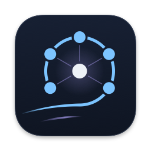

# Zephyr Mesh design system

This folder is the single design source for the two desktop replay apps:

- the macOS app (SwiftUI and SceneKit) in `macos/ZephyrMeshApp/`
- the Windows app (Tkinter) in `desktop/`

Both apps replay a recorded simulation. Neither one talks to a radio, camera, motor, or drone. The design system keeps them looking and wording things the same way, and keeps them honest about what the data contains.

A visual version of the tokens (swatches, contrast ratios, type, spacing, status levels, icon) is in `design/reference.html`. Open it in any browser; it needs no network.

Contents: [1 Principles](#1-principles) · [2 How the system works](#2-how-the-system-works) · [3 Color](#3-color) · [4 Status language](#4-status-language) · [5 Type, spacing, radii, motion, layout](#5-type-spacing-radii-motion-layout) · [6 Components](#6-components) · [7 Voice and wording](#7-voice-and-wording) · [8 Iconography and the app icon](#8-iconography-and-the-app-icon) · [9 Platform mapping](#9-platform-mapping) · [10 Keyboard shortcuts](#10-keyboard-shortcuts) · [11 Checklist for a new screen](#11-checklist-for-a-new-screen)

> Keeping this file current: sections 3, 4, 5 and 10 restate values from `design/horizon_tokens.json` and `design/ui_text.json`. When those files change, regenerate `design/reference.html` (it is always exact) and update the matching tables here. Section 6 describes the views as they are in the source files it cites; re-read those files when a view changes.

## 1. Principles

**The first question is "is the tracker OK?"** The top of the window answers it before anything else: the status strip shows the tracking state as a shape, a color and a word ("Tracking held", "Tracking partial (47 of 50)", "Tracking lost", "Waiting for first target packet"), then four team numbers. Detail (one drone, raw vectors, hashes) is always one step further in, never in the way.

**Show only what the run contains.** Every number on screen comes from the replay file. One shared presentation layer (`desktop/presentation.py`) reads the replay values and derives the display metrics (estimate error, speed, heading, link statistics, status levels); the views only format what it returns, plus raw values the Mac fixture copies straight from the run. A value the run does not hold reads **"Not recorded"** in the secondary text color. It is never shown as 0, as a blank, or as a guess.

**Say what this is, once.** Each main window has exactly one badge, **"Simulation replay"** (`honesty.badge` in `ui_text.json`), plus an **About this replay** window that states the run's status, evidence boundary, command authority and failsafe, lists what is not in the replay, and shows the command that regenerates it. Tests limit how often the word "synthetic" can appear in UI strings, so the badge text lives in one place (`tests/test_macos_ui_hygiene.py`, `tests/test_windows_ui_hygiene.py`).

**Color is never the only signal.** Every status pairs a shape, a color and a word (section 4).

**Calm by default.** No shadows or gradients in the app UI (the rule is the `comment` in `horizon_tokens.json`), hairline dividers, one accent color, and red or amber only when something is wrong. Motion only follows something the user did.

## 2. How the system works

### The two source files

| File | Holds |
|---|---|
| `design/horizon_tokens.json` | Colors for dark and light, 3D scene colors, type scale, spacing, radii, motion, layout sizes, and the contrast rules |
| `design/ui_text.json` | The honesty badge, status strip labels, status levels (word, shape, color), shape names per platform, display thresholds, field labels, drone naming, keyboard shortcuts, event sentence templates |

Palette values, type sizes, spacing, radii and layout sizes, and the shared status, field, menu, transport, inspector and shortcut labels, reach the views only through the generated modules below. Some view-specific sentences (empty states, hints, section titles) still live in the view source.

### The generator and the drift check

`tools/generate_design.py` reads both JSON files and writes two generated modules:

- `macos/ZephyrMeshApp/Sources/ZephyrMeshApp/DesignSystem.swift` (`Theme`, `ScenePalette`, `TypeScale`, `Space`, `Radius`, `Motion`, `LayoutMetrics`, `UIText`)
- `desktop/design_tokens.py` (`palette()`, `scene3d()`, `TYPE`, `SPACE`, `RADIUS`, `MOTION_MS`, `LAYOUT`, `SHORTCUTS`, `UI_TEXT`)

Both start with `GENERATED FILE. Do not edit.` Run `python3 tools/generate_design.py --check` to see whether they still match the JSON; it exits 1 and names the stale file if not. `tests/test_design_system.py` runs that check and also proves a JSON edit flows into both outputs.

### The contrast check

`tools/check_contrast.py` computes the WCAG contrast ratio for every text color on the background, the surface, and both fills, in both themes, and checks that the stored `selectionFill` and `hoverFill` hex values really are the blend their `base`, `alpha` and `over` describe. A pair below its target fails the run unless it is listed under `contrast.needs-approval`; a listed pair that now passes is reported as a stale mark. Results are in section 3.

### The shared presentation layer

`desktop/presentation.py` turns a frame of the replay into what the screen shows: each drone's status level, the tracking headline, group rows, the team summary, link statistics, estimate error p95, and event sentences. It reads thresholds, words and templates from the generated `UI_TEXT`. The Windows app calls it live through `desktop/replay_session.py`.

### The generated Mac fixture

The Mac app does not run Python. `tools/build_native_fixture.py` reads `runs/s7-swarm/run.json` (and its `manifest.json`), runs the same presentation code, and writes `macos/ZephyrMeshApp/Sources/ZephyrMeshApp/Resources/demo_swarm.json`, which embeds the presentation records next to the raw positions. Swift code only formats those records (`Presentation.swift`). `tools/build_presentation_golden.py` writes `design/golden/s7_presentation.json`, the checked-in expected output, and `tests/test_presentation.py` and `tests/test_native_fixture.py` check that the golden file, the fixture and the code agree.

### Changing a color or a label in 4 steps

1. **Edit the source.** A color goes in `design/horizon_tokens.json`; a label, word, threshold or template goes in `design/ui_text.json`. If you change a color that a fill is derived from, update the fill's `hex` too (step 3 tells you the right value).
2. **Regenerate the modules.** `python3 tools/generate_design.py`
3. **Check contrast.** `python3 tools/check_contrast.py` must exit 0. If a pair drops below 4.5:1, pick a different value; adding a `needs-approval` entry is a decision for the project owner, not a fix.
4. **Rebuild what depends on it, then test.** If presentation wording changed, run `python3 tools/build_presentation_golden.py` and `python3 tools/build_native_fixture.py`. Always run `python3 tools/build_design_reference.py`. If you changed a dark color the icon uses (background, surface, lineStrong, text, accent, keepOut), run `python3 tools/build_icon.py` on a Mac. Then run `python3 -m pytest -q`.

## 3. Color

The palette is called Horizon: a night-sky navy with a light sky blue accent. Dark is the default theme. Light exists for bright rooms. Values below are from `design/horizon_tokens.json`.

| Token | Dark | Light | Job |
|---|---|---|---|
| `background` | `#0F1522` | `#F6F8FB` | Window background and the 3D floor |
| `surface` | `#172033` | `#FFFFFF` (proposed) | Panels: team list, inspector, status strip, timeline, events |
| `line` | `#2B3A55` | `#D5DCE6` (proposed) | Hairline dividers, tile borders, scroll track, scene grid |
| `lineStrong` | `#5B6B88` | `#7D8AA1` (proposed) | Badge border, event ticks on the scrubber, hovered button border, heavier grid lines |
| `text` | `#EEF2F7` | `#1B2433` | Primary text and values |
| `textSecondary` | `#9AA8C0` | `#56627A` | Labels, captions, "Not recorded", the neutral drone glyph |
| `accent` | `#7CC4FF` | `#1F6FD1` | Selected drone, focus ring, scrubber fill and thumb |
| `target` | `#FFB38A` | `#A8501C` (proposed) | The target ring in the scene |
| `keepOut` | `#B4A7FF` | `#5E4BC4` (proposed) | Keep-out volume in the scene |
| `ok` | `#5FD39B` | `#1E7F4F` | Status OK only |
| `caution` | `#FFC857` | `#8A5A00` | Status Late only |
| `alert` | `#FF5C5C` | `#C62828` | Status Lost or Inactive, and the load-failure symbol |
| `info` | `#7CC4FF` | `#1F6FD1` | Info events |
| `onAlert` | `#0F1522` | `#FFFFFF` | Text placed on an alert or caution fill |
| `selectionFill` | `#273A54` | `#E0EBF9` | Selected row, pressed button, selected segment (accent at 0.16 over surface in dark, 0.14 in light) |
| `hoverFill` | `#242D3F` | `#F4F4F5` | Row or button under the pointer (text at 0.06 over surface in dark, 0.05 in light) |

"Proposed" means the token file marks the light value `"status": "proposed"`: it is in use but still waiting for sign-off.

The 3D scene has its own small palette (`scene3D`), built from the tokens above: drone body, arms and rotor discs use `textSecondary`, the target ring uses `target`, the keep-out volume is `keepOut` at 0.18 alpha, the grid uses `line`, and the floor uses `background`.

### Red and amber mean alerts only

`alert` (red) and `caution` (amber) are status colors: `caution` marks Late, `alert` marks Lost and Inactive, and `alert` is also the symbol on the "replay could not be loaded" screen. They are never used for decoration, branding, selection, or emphasis. The app icon uses none of them.

### Contrast results

Output of `python3 tools/check_contrast.py` on this branch: 78 pairs checked (39 per theme), **72 PASS, 6 NEEDS-APPROVAL, 0 FAIL**, no stale fill values, exit code 0. Text needs 4.5:1; `lineStrong` needs 3:1 because it is a non-text line.

The closest passes, worth knowing before you nudge a value: dark `lineStrong` on `surface` 3.02:1 (needs 3.0), light `ok` on `hoverFill` 4.54:1, light `target` on `selectionFill` 4.55:1, dark `alert` on `hoverFill` 4.56:1, light `accent` and `info` on `background` 4.64:1.

The six pairs below are too low for text and are avoided. The apps never put accent, info, OK or alert text on these fills; a selected row shows its words in `text` and keeps the status color for the shape only (`StatusLabel` in `Components.swift`).

| Theme | Text color | On fill | Ratio |
|---|---|---|---|
| dark | `alert` | `selectionFill` | 3.81:1 |
| light | `accent` | `selectionFill` | 4.10:1 |
| light | `ok` | `selectionFill` | 4.14:1 |
| light | `info` | `selectionFill` | 4.10:1 |
| light | `accent` | `hoverFill` | 4.49:1 |
| light | `info` | `hoverFill` | 4.49:1 |

These ratios are computed from hex values. Nobody has measured them on a real screen yet.

## 4. Status language

Every status is three things at once: a **shape**, a **color**, and a **word**. People with color blindness, a washed-out projector, or a grayscale screenshot still get the shape and the word, and a screen reader gets the word. Levels come from `ui_text.json` (`statusLevels`, `statusShapes`).

| Level | Word | Shape | Color token | macOS symbol | Windows glyph |
|---|---|---|---|---|---|
| `ok` | OK | filled circle | `ok` | `circle.fill` | ● |
| `caution` | Late | filled triangle | `caution` | `triangle.fill` | ▲ |
| `alert` | Lost (or Inactive) | filled square | `alert` | `square.fill` | ■ |
| `waiting` | Waiting | hollow circle | `textSecondary` | `circle` | ○ |
| `unavailable` | Not recorded | dash | `textSecondary` | `minus` | – |
| `info` | Info | info mark | `info` | `info.circle` | ⓘ |

The Windows app draws these shapes as small antialiased PNGs (`STATUS_SHAPES` in `desktop/ui_icons.py`) rather than font glyphs, so they look the same on every font; the glyphs in the table are the text fallback stored in `ui_text.json`.

**How a drone gets its level** (`status_for_agent` in `desktop/presentation.py`): an inactive drone is Lost with the word "Inactive"; a drone with no fused target estimate, or no target age, is Waiting; otherwise its target age decides.

**Display thresholds** (`displayThresholds` in `ui_text.json`):

| Target age | Level |
|---|---|
| below 0.15 s | OK |
| 0.15 s or more | Late |
| 0.30 s or more | Lost |

These are display choices from the project's research notes, not safety limits. The JSON says so in each threshold's `note`.

**Team headline** (`tracking_headline`): "Waiting for first target packet" until any active drone has an estimate; "Tracking held" when every active drone's target age is under the Lost threshold; "Tracking lost" when none is; otherwise "Tracking partial (N of M)".

## 5. Type, spacing, radii, motion, layout

### Type scale

| Role | Size | Weight | Use |
|---|---|---|---|
| `caption` | 12 | regular | Secondary labels only |
| `body` | 13 | regular | Most text and values |
| `bodyStrong` | 13 | semibold | Status words, section headers, row names |
| `headline` | 15 | semibold | Status shape in the strip, missing strip values |
| `title` | 20 | semibold | Tracking headline, drone name in the inspector, window titles |
| `metric` | 22 | semibold, tabular digits | Status strip numbers |
| `metricSmall` | 15 | semibold, tabular digits | Inspector metric tiles |
| `mono` | 12 | regular | Hashes and IDs inside Details only |

Fonts: SF Pro through `Font.system` on macOS (SF Mono or Menlo for mono); Segoe UI Variable Text with Segoe UI as fallback on Windows (Cascadia Mono or Consolas for mono). Sizes are points on macOS; on Windows they are scaled by the display DPI (`ui_scale` in `desktop/ui_theme.py`). Numbers use tabular digits so columns do not jitter during playback.

### Spacing

`xxs` 2, `xs` 4, `sm` 8, `md` 12, `lg` 16, `xl` 24, `xxl` 32. Use these only. Small sums such as `sm + xxs` appear where a control needs an in-between value; a brand new raw number does not.

Common uses: 16 around panel content, 12 between strip and list sections, 8 inside rows and between related controls, 2 to 4 between buttons in one group.

### Radii

`small` 4 for controls, panels, rows and the badge. `medium` 8 for sheets only.

### Motion

| Token | Value |
|---|---|
| `fastMs` | 120 ms (group expand and collapse) |
| `standardMs` | 180 ms (scrolling to a selection, new events) |
| `curve` | ease-out |
| `userTriggeredOnly` | true: nothing moves unless the user (or playback they started) caused it |
| `reducedMotionMs` | 0 |

With Reduce Motion on (macOS) or animations turned off in Windows settings (`system_reduced_motion` in `desktop/ui_settings.py`), durations become 0 and the camera jumps instead of easing (`Motion.duration` in `DesignSystem.swift`, `reduced_motion` in `desktop/scene_view.py`).

### Layout sizes

| Token | Value | Used for |
|---|---|---|
| `windowMinWidth` × `windowMinHeight` | 1180 × 760 | Smallest window |
| `windowDefaultWidth` × `windowDefaultHeight` | 1440 × 900 | First launch |
| `sidebarWidth`, `sidebarIdealWidth` | 260, 300 | Mac team list (min and ideal) |
| `sidebarWidthWindows` | 340 | Windows team list |
| `inspectorWidth`, `inspectorMaxWidth` | 300, 360 | Inspector column |
| `sceneMinWidth` | 520 | 3D view |
| `rowHeight` | 28 | List rows and the minimum button size |
| `eventListHeight`, `eventPaneHeight` | 128, 192 | Event list and its pane |

## 6. Components

Each entry: what it is for, what it is made of, its states, and where it lives.

### Status strip
- **Purpose:** answer "is the tracker OK?" at a glance.
- **Anatomy:** a Tracking cell (caption "Tracking", status shape in headline size, headline text in title size), then four metrics with a caption over a value: Estimate error p95, Target link delay, Target packet loss, Target age (labels from `statusStrip`). Vertical hairlines separate the metrics. Surface background, hairline below.
- **States:** values in `metric` type; a missing value shows "Not recorded" in `headline` type and `textSecondary`. Target age shows a newest to oldest range (for example "0.05–0.40 s") when drones differ.
- **Where:** `StatusStripView.swift` (one row when it fits, otherwise tracking on its own row above the four metrics); Windows: the strip built in `desktop/windows_preview.py`.

### Simulation replay badge
- **Purpose:** say once, everywhere, that this is a recorded simulation.
- **Anatomy:** caption text in `textSecondary`, a 1 pt `lineStrong` border, `small` radius. Never a filled pill. Tooltip: every value comes from a recorded simulation file, not a live connection.
- **Where:** `HonestyBadge` in `Components.swift` (toolbar); `Badge.TLabel` in `desktop/ui_theme.py` (title row).

### Team list: group rows and drone rows
- **Purpose:** show 50 drones without 50 rows. There is one group row per status level and word (all late drones form one group, all OK drones another), and inside a group the drones are listed stalest first (oldest target age first).
- **Anatomy:** a summary line on top ("50 drones: 47 OK, 3 late"), the filter field, column captions (Status, Age, Loss), then group rows (chevron, status shape, status word, "N drones", Age, Loss) with their drone rows (compact name such as D07, Age, Loss) indented under them. Rows are `rowHeight` tall.
- **States:** groups sort Lost first, then Late, then the rest, with OK last; groups that are not OK are open by default and OK groups are closed. Hover uses `hoverFill`, selection uses `selectionFill`, the selected drone's name turns `bodyStrong`. A keyboard-focused list gets a 1 pt accent outline. A group's target age, link delay and packet loss are shown as ranges (min to max) when its members differ. A missing cell shows a dash with "Not recorded" as its tooltip; if both cells are missing the row says "Not recorded". Right-click: Focus Camera, Show in Inspector, Copy Drone ID.
- **Filter rule** (`teamFilter` in `ui_text.json`, `filter_group_rows` in `desktop/presentation.py`): late and lost groups are pinned (`pinnedLevels`) and keep every member whatever you type, with the note "Late and lost drones stay listed." Every other group keeps only the drones whose name matches and disappears when none do. While a filter is active the list says "Showing N of M"; when nothing matches it shows an empty state such as `No drones match "D99"` with a Clear filter action.
- **Where:** `TeamListView.swift` (`GroupRow`, `DroneRow`, `TeamContextMenu`); Windows: a `ttk.Treeview` styled `Zephyr.Treeview` in `desktop/windows_preview.py` and `desktop/ui_theme.py`.

### Filter field
- **Purpose:** find a drone by name (D07, Drone 07, or its raw ID).
- **Anatomy:** filter icon, placeholder "Filter drones", clear button when not empty. `background` fill inside the `surface` panel, `line` border, `small` radius, `rowHeight` tall.
- **States:** focus turns the border `accent`. Escape clears it and leaves the field. While it has focus, single-key shortcuts are off.
- **Where:** `filterField` in `TeamListView.swift`; `Filter.TEntry` plus `Placeholder` in `desktop/ui_theme.py` and `desktop/ui_widgets.py`.

### Inspector
- **Purpose:** everything about one selected drone.
- **Anatomy, top to bottom:** drone name ("Drone 07", title type) with its status label; four metric tiles in a 2 by 2 grid (Target age, Estimate error, Target link delay, Target packet loss); "Position and motion" (altitude, speed, heading); "Neighbors" (count, nearest, neighbor link delay and loss); a collapsed **Details** section with raw position, velocity and fused target vectors, constraint flags, hardware profile parts, and the drone ID in `mono`.
- **Metric tile:** caption over a `metricSmall` value, 1 pt `line` border, `small` radius. Missing values drop to `body` type in `textSecondary`.
- **States:** nothing selected shows an empty state: "No drone selected" and "Click a drone in the team list or the scene." macOS remembers whether Details was open.
- **Where:** `InspectorView.swift`, `MetricTile` and `ValueRow` in `Components.swift`; `MetricTile`, `KeyValueGrid`, `Disclosure` in `desktop/ui_widgets.py`. Toggle with I.

### Timeline and transport controls
- **Purpose:** move through the replay.
- **Anatomy:** Restart, Step back, Play or Pause, Step forward; a scrubber with event ticks; the time ("12.40 / 30.00 s"); the speed choice (0.1x, 0.25x default, 1x).
- **Scrubber:** 4 pt `line` track, `accent` fill and 14 pt thumb with a surface ring; `lineStrong` ticks under the track mark frames with events. On macOS they are 2 by 6 pt and their tooltip lists that frame's events; on Windows they are scaled to the display and have no tooltip. Dragging pauses and snaps to the nearest frame.
- **States:** on macOS, Restart and Step back are disabled at the start and Step forward at the end. Disabled controls use a dimmed `textSecondary`.
- **Placement:** playback controls live in this timeline row. The Mac toolbar holds view controls only (3D or Top, About this replay, the inspector toggle).
- **Where:** `TimelineView.swift` (`ReplayScrubber`, `SegmentedChoice`); Windows: `_build_timeline` in `desktop/windows_preview.py` and `TimelineSlider` in `desktop/ui_widgets.py`.

### Event list
- **Purpose:** a plain-language log of what changed.
- **Anatomy:** caption "Events" (macOS adds the hint "Click an event to jump to it"); rows with status shape, status word, time, and the sentence (section 7). Oldest at the top, newest at the bottom; it scrolls to the newest as the replay plays.
- **States:** on macOS, events at the current time use `text` and earlier ones `textSecondary`; Windows defines the same past style but does not apply it yet, so all its rows use one color. Hover uses `hoverFill`. On both, clicking an event pauses and seeks to it.
- **Drone lists in events:** at most 5 compact names, then "+N more" (`eventDroneList` in `ui_text.json`); the event record still keeps every ID.
- **Where:** `EventListView.swift`; `Events.Treeview` in `desktop/windows_preview.py`.

### Viewer windows
Evidence reports, scenario runs and About this replay open in their own windows, and they all follow one order:

1. **Verdict or plot first:** the report's declared status and limitations, or the scenario run's top-down plot of the selected frame with an altitude rail.
2. **Summary second:** plain labeled rows using the shared field labels.
3. **Details last, collapsed:** hashes, schemas, versions, provenance, raw data, in `mono` where it is an ID or hash.

Where: `EvidenceReportView.swift`, `ScenarioRunView.swift`, `AboutReplayView.swift`; `evidence_window`, `scenario_window`, `about_window` in `desktop/ui_viewers.py`.

### Buttons

| Kind | Look | macOS | Windows |
|---|---|---|---|
| Icon button | Icon in `text`, no border at rest, `hoverFill` on hover, `selectionFill` when pressed or active; at least 28 by 28 | `QuietButtonStyle` | `Icon.TButton` (1 px `line` border, padding 6 by 5) |
| Text button | Body text, 1 px border, same fills | not used; viewers use icon buttons such as Copy command | `Tool.TButton` (padding 12 by 5), for example Play and Copy |
| Disclosure | Chevron plus `bodyStrong` title, no border | `DisclosureGroup` | `Link.TButton` inside `Disclosure` |
| Segmented choice | Selected segment: `text` on `selectionFill`, semibold; others `textSecondary` | `SegmentedChoice` | `Segment.Toolbutton` |

Spacing rules: buttons in one group sit 2 pt apart (macOS) or 4 pt apart (Windows); separate groups are 12 to 16 pt apart. Every icon-only button has a tooltip naming the action; on Windows the tooltip also gives the shortcut. Focus shows as an `accent` border, never the system accent color.

### Empty and error states
- **Empty:** a quiet icon in `textSecondary`, a short `bodyStrong` line saying what is missing, and one `body` line saying what to do. Example: "No drone selected" / "Click a drone in the team list or the scene."
- **Replay failed to load (macOS):** the alert status shape, "The replay could not be loaded", the decoder's message (selectable), and "Rebuild the replay fixture and the app, then open it again." (`LoadFailureView` in `ZephyrMeshApp.swift`). The app never fills in invented drones.
- **File would not open:** "Could not open evidence report" or "Could not open scenario run" with the validation message (`AppStore.swift`; `messagebox.showerror` in `desktop/windows_preview.py`).
- **Windows start-up failure:** "Zephyr Mesh could not start." with the error, the path of a written diagnostic file, and a hint about extracting the whole ZIP (`show_startup_failure`).

### The 3D scene
- **Drone glyph:** an X-frame quadcopter in one neutral color (`textSecondary`). On macOS it is a procedural model at true scale from the drone's hardware profile (arm length and propeller size, `DroneModel.swift`); on Windows a Canvas drawing with four rotor discs (`desktop/scene_view.py`). The selected drone uses `accent`. Late and lost drones fade (opacity 0.38 on macOS) but keep their shape.
- **Target:** a ring in `target` with a thin stem down to the floor and a small foot ring.
- **Keep-out sphere:** `keepOut` at 0.18 alpha with an outline ring that always faces the camera and a second ring at the equator (`updateKeepOut` in `SceneController.swift`). K shows or hides it. The Mac fixture builds the sphere from the scenario constraints (0.75 m radius); the Windows scene draws keep-out volumes only when the replay frame contains them, and the canonical run's frames have none.
- **Floor grid:** 1 m squares with a heavier line every 5 m, on the `background` floor.
- **Orbit camera:** drag to orbit, scroll or pinch to zoom, both eased and clamped. Pitch stays between 10 and 85 degrees, there is no roll and no panning, and distance stays within 3 times the swarm radius (`OrbitCamera.swift`, `desktop/scene_projection.py`). T switches to a straight-down top view (on Windows that view may sit up to 6 times the swarm radius away). F focuses the selected drone, R resets. The Mac scene never uses SceneKit's free camera (`tests/test_macos_ui_hygiene.py`).

## 7. Voice and wording

- **Plain sentences.** "Target packet lost for 3 drones", not "PKT_LOSS x3".
- **Units on labels.** The label carries the unit and the value stays a number: "Position (m)" over "6.00, 0.00, 1.50". Single values show their unit: "0.12 s", "18 ms", "2.5%".
- **No snake_case on screen.** Every data key has a label in `fieldLabels` (`agent_id` reads "Drone ID", `seed` reads "Random seed"). A key without a label falls back to spaces and a capital letter, never the raw key (`Format.label` in `Presentation.swift`, `field_label` in `desktop/ui_format.py`). Hygiene tests reject snake_case in visible strings.
- **Drone names.** "D07" in lists, "Drone 07" in headings (`droneNaming`).
- **Missing is "Not recorded".** Never 0, never "N/A", never empty.
- **No hype and no em dashes.** Describe, do not sell.

Event sentences come from `eventTemplates`:

| Template | Example |
|---|---|
| `replayLoaded` | Replay loaded: 50 drones |
| `estimateReached` | Target estimate reached 48 of 50 drones |
| `estimateLate` | 3 drones newly late: D04, D17, D33 (0.18 s) |
| `backOnTime` | 3 drones back on time |
| `inactive` | D12 went inactive |
| `packetLost` | Target packet lost for 2 drones |

| Do | Don't |
|---|---|
| Tracking partial (47 of 50) | Degraded mode |
| Target age 0.32 s, status Lost | Red dot with no word |
| Not recorded | 0.00, N/A, or a blank |
| Simulation replay | Live, Connected, or Online |
| Estimate error p95 | est_err_p95 |
| Could not open evidence report: (reason) | Error |

## 8. Iconography and the app icon

### Interface icons
Status shapes are listed in section 4. Transport and disclosure icons are SF Symbols on macOS (`backward.end.fill`, `backward.frame.fill`, `play.fill`, `pause.fill`, `forward.frame.fill`, `chevron.right`) and matching shapes drawn as PNGs on Windows (`ICONS` in `desktop/ui_icons.py`). Icons take the `text` color, or `textSecondary` when they are hints.

### The app icon

**Idea.** A zephyr is a gentle west wind. A thin gust comes in from the west (left), thickens, and wraps around into an orbit. Five drones sit on that orbit, and thin links run from each one to a bright point in the middle: the target the team tracks together. A second, shorter breeze runs under the gust so the motion reads as moving air.

**Construction** (`tools/make_icon.swift`, 1024 by 1024 design space):

- Body: an 824 by 824 rounded square centered on the canvas (100 px margin), continuous corners with radius 185, following the macOS Big Sur icon grid. A soft drop shadow (10 px down, 28 px blur) and a subtle top-to-bottom gradient from `surface` to `background`. A faint `lineStrong` inner edge keeps the tile's outline visible on a dark Dock.
- Colors, all read from the dark palette in `horizon_tokens.json`: orbit and drones in `accent` (sky), links, glow and breeze in `keepOut` (lavender), the tracked point in `text`. No red, amber, or green.
- The gust and the orbit are one stroke: a curve that meets the circle at the bottom, tangent to it, then runs most of the way around and ends under the last drone. Each drone has a small gap around it so lines never touch the dot.

**Small-size rule.** At 16 and 32 px, the links, the glow and the breeze are left out; the orbit gets thicker, the center gets larger, and the drones shrink into the ring, so it reads as a gust wrapped around a point. At 48 and 64 px the full design is drawn, and the thin links and the breeze are kept at least one pixel wide.

**Windows frames** use the same drawing on a larger body (40 px margin, no drop shadow), because Windows adds no margin of its own.

**Note on the no-gradient rule.** The app UI uses no shadows or gradients. The icon is the one exception: it follows the macOS app icon grid, which expects a drop shadow and depth.

**Files** (all written by `python3 tools/build_icon.py`, which needs macOS with Swift and `iconutil`):

| File | Contents |
|---|---|
| `design/icon/ZephyrMesh.icns` | macOS icon: 16, 32, 64, 128, 256, 512 and 1024 px |
| `design/icon/ZephyrMesh.ico` | Windows icon: 16, 24, 32, 48, 64, 128, 256 px, PNG frames (packed by `tools/pack_ico.py`, standard library only) |
| `design/icon/ZephyrMesh-256.png`, `design/icon/ZephyrMesh-1024.png` | Flat PNGs for docs and the reference page |

The build is deterministic: running it twice gives identical bytes. `tests/test_app_icon.py` checks the sizes inside each file by reading their headers. The apps do not use these files yet; wiring them into `macos/build_app.py` and the Windows build is a separate step.

## 9. Platform mapping

| Concept | macOS (SwiftUI) | Windows (Tk) |
|---|---|---|
| Generated tokens | `DesignSystem.swift`: `Theme`, `TypeScale`, `Space`, `Radius`, `Motion`, `LayoutMetrics`, `UIText` | `desktop/design_tokens.py`: `palette()`, `TYPE`, `SPACE`, `RADIUS`, `MOTION_MS`, `LAYOUT`, `UI_TEXT` |
| Theme and appearance | `@Environment(\.palette)`; Settings > Appearance (System, Dark, Light) | `Theme` and `configure_styles` on ttk `clam` (`ui_theme.py`); View > Appearance, saved in `~/.zephyr-mesh/settings.json` |
| Status shape | SF Symbol from `statusShapesMacOS` (`StatusShape`) | PNG shape from `ui_icons.STATUS_SHAPES` (`ImageBank.status`) |
| Status label | `StatusLabel` | shape image plus word in a label |
| Honesty badge | `HonestyBadge` | `Badge.TLabel` |
| Team list | `TeamListView` (`GroupRow`, `DroneRow`) | `ttk.Treeview`, style `Zephyr.Treeview` |
| Filter | `TextField` in `filterField` | `Filter.TEntry` with `Placeholder` |
| Metric tile | `MetricTile` (`Components.swift`) | `MetricTile` (`ui_widgets.py`) |
| Label and value rows | `ValueRow`, `StackedValue` | `KeyValueGrid` |
| Collapsible Details | `DisclosureGroup` | `Disclosure` |
| Buttons | `QuietButtonStyle`, `SegmentedChoice` | `Icon.TButton`, `Tool.TButton`, `Link.TButton`, `Segment.Toolbutton` |
| Scrubber | `ReplayScrubber` | `TimelineSlider` |
| Event list | `EventListView` | `Events.Treeview` |
| Tooltip | `.help(...)` | `Tooltip` |
| 3D scene | SceneKit: `SceneController`, `DroneModel`, `OrbitCamera` | Canvas: `scene_view.py`, `scene_projection.py` |
| Viewer windows | `EvidenceReportView`, `ScenarioRunView`, `AboutReplayView` | `evidence_window`, `scenario_window`, `about_window` |
| Reduced motion | `accessibilityReduceMotion` with `Motion.duration` | Windows animation setting via `system_reduced_motion` |
| Source rules test | `tests/test_macos_ui_hygiene.py` | `tests/test_windows_ui_hygiene.py` |

## 10. Keyboard shortcuts

From `shortcuts` in `ui_text.json`. "Primary" is Command on macOS and Control on Windows.

| Action | Keys |
|---|---|
| Play/Pause | Space |
| Step forward | Right arrow |
| Step back | Left arrow |
| Restart | Home |
| Focus selected drone | F |
| Reset camera | R |
| Toggle 3D/top view | T |
| Show/hide keep-out volume | K |
| Show/hide inspector | I |
| Open evidence report... | Primary + O |
| Open scenario run... | Primary + Shift + O |
| Focus team filter | Primary + L |
| About this replay | Primary + I |

Single-key shortcuts never fire while a text field has focus (`shortcutRule`). On Windows a focused list or button also keeps its own arrow and Space keys.

## 11. Checklist for a new screen

Before you open a pull request for a new window, panel or view:

- [ ] It answers one question, and the answer is at the top.
- [ ] Every color, size, radius and duration comes from the generated module. No hex values, no raw font sizes, no system accent colors (the hygiene tests check this).
- [ ] Every visible label comes from `ui_text.json` or is a plain sentence; no snake_case, units in labels.
- [ ] Every status uses shape, color and word together, through `StatusStyle` (macOS) or the theme's status helpers (Windows).
- [ ] Missing values read "Not recorded".
- [ ] Red and amber appear only as status (Late, Lost, Inactive) or a load failure.
- [ ] Nothing claims to be live, and the "Simulation replay" badge is not repeated.
- [ ] Viewer-style windows follow verdict or plot, then summary, then collapsed Details.
- [ ] It works in dark and light; run `python3 tools/check_contrast.py` if you added a new text-on-fill pair.
- [ ] Animations are user-triggered, use `fastMs` or `standardMs`, and drop to 0 with reduced motion.
- [ ] Keyboard: reachable with Tab, a visible accent focus ring, and any new shortcut added to `ui_text.json` (never typed into the view).
- [ ] Both platforms get the same concept (section 9), or the gap is written down.
- [ ] `python3 tools/generate_design.py --check`, `python3 tools/build_design_reference.py --check` and `python3 -m pytest -q` pass.
